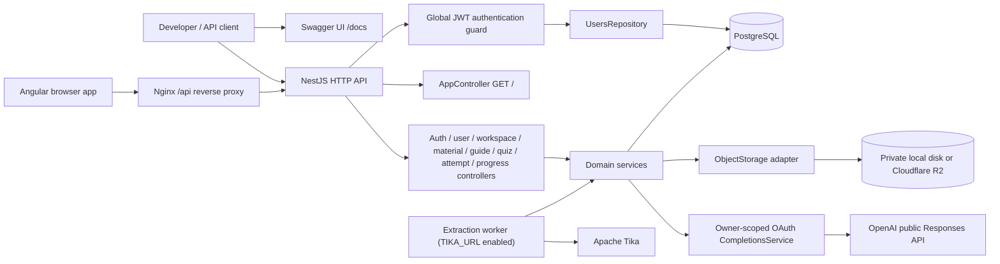
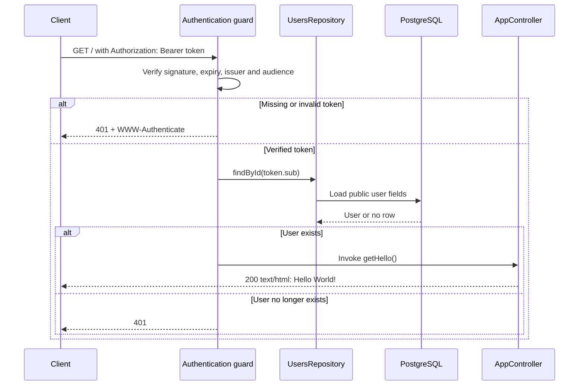

# Architecture overview

[Documentation home](README.md) · [Database design](../../Database/DATABASE.md)

## System context

Arrows show implemented relationships. The proxy exists, but Angular application
API integration is pending.

## Current authenticated request flow

## Module/resource inventory

| Module | Implemented responsibility | HTTP status |
| --- | --- | --- |
| App | Starter authenticated greeting | `GET /` |
| Auth | Password registration/sign-in and access-token issuance | `/auth/register`, `/auth/sign-in` |
| Users | Public profile lookup | `/me` |
| Workspaces | Ownership-scoped collections and cleanup | `/workspaces`, `/workspaces/{workspaceId}` |
| Materials | Validated document storage and extraction status | Workspace material lists/uploads; material reads/rename/delete/text/retry |
| Processing jobs | PostgreSQL queue and extraction completion/failure | Read-only `/materials/{materialId}/jobs`; worker mutations internal |
| Study guides | Store/read validated Markdown content | Material guide lists/creation; guide reads/rename/delete |
| Quizzes | Persist typed quizzes; optional OAuth generation; hide answers while taking | Material quiz lists/creation/generation; quiz reads/rename/delete |
| Attempts | Server grading and immutable assessment history | Quiz attempt lists/submission, personal history and result reads |
| Progress | Aggregate user quiz history | `/me/progress`, `/me/progress/overview` |

The migrated database defines eleven relational tables, four enums and a progress view. These are not
automatically API response models. Only models returned by exposed endpoints
belong in the current public OpenAPI contract.
