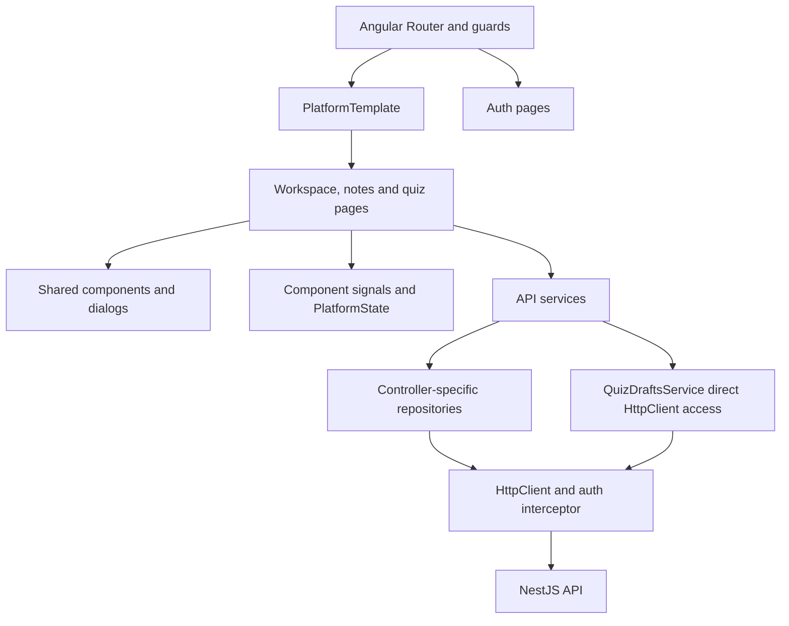
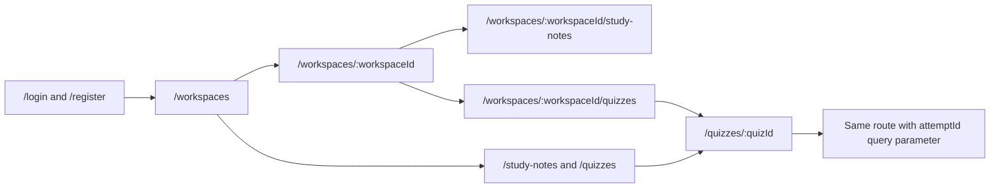
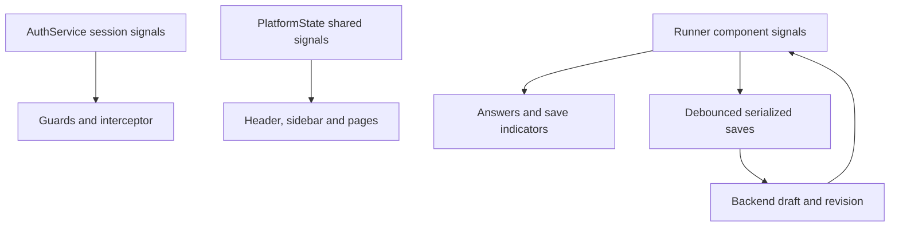

# Frontend architecture

The frontend is an Angular 22 standalone SPA, organized by feature rather than NgModules. Pages compose shared UI and delegate data access to injectable services. This describes current code, not a proposed redesign.

## Responsibilities

| Area | Responsibility |
| --- | --- |
| features/auth | Login, registration, form validation, route guards |
| features/workspaces and features/workspace | Workspace listing, document selection and upload |
| features/study-notes | Study guide presentation |
| features/quizzes | Quiz lists, draft editing, submission and results |
| shared/components | Header, navigation, dialogs and reusable UI |
| shared/layout | Common shell and PlatformState |
| shared/services | API contracts, adapters, services and repositories |

## Routes and navigation

Login and registration are outside the authenticated shell. Guards protect the shell and redirect signed-in users away from authentication pages. Feature pages use lazy loadComponent imports.

Unknown shell routes redirect to workspaces; there is no dedicated not-found page.

## State ownership

Component signals hold local loading, selection, dialog and error state. PlatformState is a root injectable store for workspace selection, navigation, header search and mobile-menu state. AuthService owns the session signals and localStorage persistence. Quiz draft persistence belongs to the backend; the runner retains pending edits in memory and serializes saves.

## Technology suitability

These are implementation-based justifications, not historical decision records.

- Angular provides routing, dependency injection, forms and HTTP integration within one framework.
- Standalone components and lazy routes keep feature boundaries identifiable without mandatory NgModules.
- Signals suit synchronous UI state; RxJS fits HttpClient streams and request composition. A separate Redux-style dependency is unnecessary for the current shared-state scope.
- TypeScript defines request, response and UI contracts. Adapters separate transport shapes from presentation models.
- SCSS component styles and global CSS tokens support a cohesive custom UI without a UI-library dependency.

Source entrypoints: [routes](../../Frontend/src/app/app.routes.ts), [providers](../../Frontend/src/app/app.config.ts), [shared state](../../Frontend/src/app/shared/layout/platform-state.service.ts).

